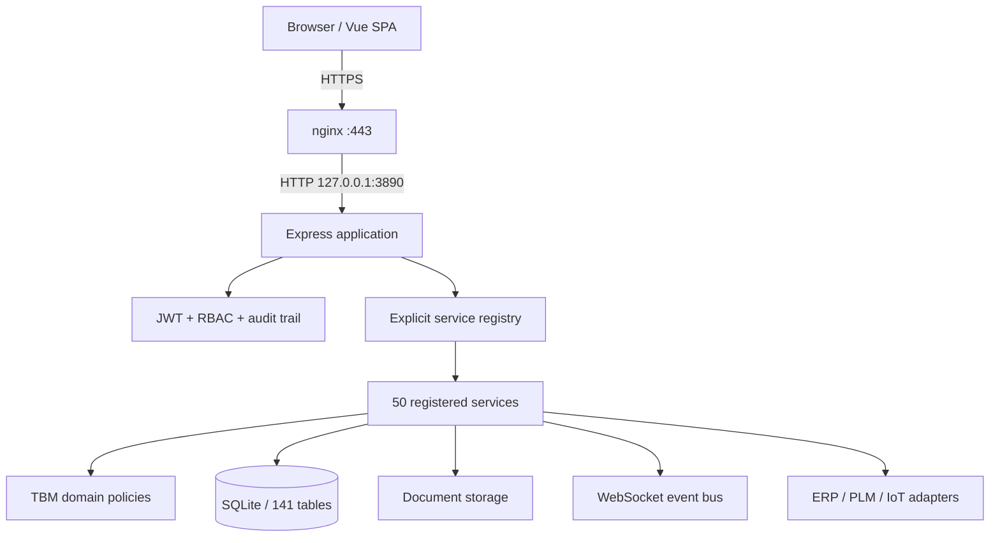

# Factory MES Architecture

> TBM-MES v2.4, updated 2026-07-21
> Runtime: Node.js 22, Express 4, Vue 3, SQLite, nginx, systemd

## 1. System Context



The deployable system is one Node.js process. nginx terminates TLS and proxies requests to
`127.0.0.1:3890`; the application serves both `/api/*` and the built SPA. SQLite uses WAL,
foreign keys, a busy timeout, and a slow-query profiler.

## 2. Dependency Direction

The enforced dependency direction is:

```text
frontend/router -> frontend/views
frontend/views -> components / composables / domain / api
frontend/components -> composables
frontend/composables -> api / domain

server/app composition -> routes -> services -> app/domain
                                      |        -> shared catalogs
                                      -> db / storage / integrations / events
```

The following reverse edges are blocked by `scripts/check-layer-boundaries.js`:

- `services/** -> routes/**`
- `app/domain/** -> services|routes|db|middleware|Express|WebSocket`
- `frontend/src/domain/** -> Vue|Element Plus|router|views|components|api`
- `frontend/src/composables/** -> frontend/src/views/**`

Composition roots such as `server.js`, `app/index.js`, `services/registry.js`, and the Vue
router may have high fan-out by design. Domain policy modules remain infrastructure-free.

## 3. Backend Assembly

`server.js` performs application assembly in this order:

1. Load environment and create the Express app.
2. Mount document raw-body handling and public root routes.
3. Load role permissions, JWT authentication, API permission checks, and audit trail.
4. Register base routes, instance routes, and admin diagnostics.
5. Register the explicit 50-service catalog through `services/register-all.js`.
6. Start IoT collection, IoT lifecycle management, and SPC monitoring.
7. Serve uploads and the production SPA.
8. Mount unified 404/error handlers.
9. Attach WebSocket handling and listen on loopback port 3890.

`app/index.js` owns only cross-cutting Express middleware: static files, security headers,
CORS, parsers, request IDs, response normalization, logging, and final error handlers.

## 4. Service Registry And Schema Evolution

Services are declared in four catalogs under `services/registry/` and dependency-sorted before
registration. Every entry declares a positive `schemaVersion`.

Service-local DDL is governed by three artifacts:

- `db/service-schema-manifest.json` records each service DDL fingerprint.
- `db/serviceMigrations.js` records applied `service@version` migrations and refuses fingerprint drift.
- `scripts/check-service-schema-versions.js` requires a version increment whenever DDL changes.

The current manifest covers 50 services, including 36 services with DDL. Traditional numbered
migrations remain under `db/migrations/`; new service-local schema changes must update the service
version and regenerate the manifest with `npm run schema:write`.

## 5. Domain Ownership

Cross-module state rules are centralized in `app/domain/`:

| Domain concept | Policy module |
|---|---|
| Equipment lifecycle | `equipmentInstance.js` |
| BOM hierarchy | `bomTree.js` |
| BOM shortage risk | `bomRisk.js` |
| Purchase shortage transitions | `purchaseShortage.js` |
| Shortage case state | `shortageCase.js` |
| Process route completeness | `processRoute.js` |
| NCR closure | `qualityNcr.js` |
| Project delivery state | `projectDelivery.js` |
| Shared status vocabulary | `statusCatalog.js` |

Simple CRUD remains transaction-script based. Cross-module state transitions must use these
policies rather than reimplement status strings. Persistence ownership is complete for
`project_cost_entries`; `shortage_cases` and `process_nodes` still have multiple bounded-context
writers and are the next repository-consolidation targets.

## 6. Frontend Structure

The frontend exposes 64 functional modules through 58 router paths. Route components are lazy
loaded. The active source currently contains 140 view files, 20 page composables, shared page
state/toolbars, and a single API facade.

Page code follows this split:

```text
views/Foo.vue                  page shell and layout
views/foo/*.vue                tabs, dialogs, repeated panels
composables/useFooPage.ts      page state and commands
composables/foo/*.ts           cohesive controller helpers
domain/*.ts                    pure frontend policies
api/                           HTTP boundary
```

The page shell must not own large data-loading workflows, and composables must never import a
view. Project launch flow definitions therefore live under `composables/projectLaunch/`.

## 7. Important Runtime Flows

### Authenticated request

```text
Browser -> nginx -> Express
  -> authMiddleware
  -> apiPermissionMiddleware
  -> auditTrail
  -> route/service adapter
  -> domain policy + SQLite transaction
  -> unified JSON response with requestId
```

### Service schema startup

```text
service registry
  -> manifest version/fingerprint validation
  -> migration proxy
  -> apply unseen DDL once or suppress previously applied DDL
  -> register service routes
```

### Production deployment

```text
clean Git worktree
  -> pre-deploy tests
  -> migrations
  -> systemd restart
  -> wait for active state
  -> poll /api/health until HTTP 200
```

`scripts/deploy.sh` refuses a dirty worktree by default. An emergency override requires the
explicit `ALLOW_DIRTY_DEPLOY=1` environment variable and is visible in deployment output.

## 8. Verification Baseline

The required structural and runtime gates are:

```bash
bash scripts/run-all-tests.sh
cd frontend && npm run typecheck && npm run build
npm audit --omit=dev
cd frontend && npm audit --omit=dev
git diff --check
```

`run-all-tests.sh` also checks route uniqueness, module/menu/router consistency, service schema
fingerprints, and layer boundaries. Service tests use injected in-memory SQLite databases; the
production database is never used as a test fixture.

## 9. Current Residual Risks

- Several cohesive page controllers and read-model registrars remain 250-330 lines. They no
  longer mix all UI/SQL concerns in one file, but should be split when their next feature lands.
- `shortage_cases` has four direct writers and `process_nodes` has nine. The domain transition
  policies are centralized, while persistence ownership remains transitional.
- The Vue router and API facade have high fan-out/fan-in intentionally as composition boundaries.

See `docs/architecture-rules.md`, `docs/service-schema-migrations.md`, `docs/deploy.md`, and the
latest report under `docs/audits/` for enforcement details.
