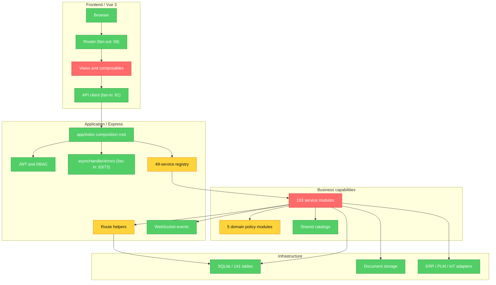

# Brooks-Lint Review

**Mode:** Architecture Audit
**Scope:** `192.168.1.73:/home/dubin/factory-mes` 全量活动源码；静态依赖扫描覆盖 425 个文件，排除配置中的归档、构建产物、依赖和临时文件
**Config:** `.brooks-lint.yaml` applied (1 risk disabled, 17 paths ignored)
**Health Score:** 64/100
**Trend:** 48 -> 64 (+16) since the previous Architecture Audit

系统运行、测试、构建和数据库完整性均健康，但核心业务编排仍集中在超长函数中，服务层边界、数据库演进约束和部署可追溯性尚未达到长期维护一套完整 TBM-MES 的要求。

---

## Module Dependency Graph

### Audit Baseline

- 49 个注册服务、548 条 API 路由、64 个前端功能模块、141 张生产表。
- 依赖环为 0；最高业务页面 fan-out 为 `MaterialCenter.vue` 的 15，`router/index.ts` 的 58 属于组合根。
- 403/403 后端测试通过；路由唯一性和模块清单检查通过；前端 `vue-tsc` 与生产构建通过。
- 根目录与前端生产依赖均为 0 个已知漏洞。
- 真实生产库 `data/mes.db`：`integrity_check=ok`，外键异常 0。
- 数据库依赖通过参数注入，内存 SQLite 测试形成了有效测试 seam；Conway's Law 因团队边界信息不足不形成 finding。

---

## Findings

### Critical

**R1 Cognitive Overload - 核心业务仍由超长编排函数承载**

Symptom: `services/equipment/service.js:18` 的 `register` 为 437 行，`frontend/src/composables/useProcessTreePage.js:27` 为 422 行，`services/delivery/readModel/exceptions.js:3` 为 409 行；另有 `materialService.js` 398 行、`deliveryService.js` 375 行、`qcService.js` 362 行、`bom/businessViews.js` 350 行和 `eco.js` 350 行的单函数热点。
Source: Fowler - *Refactoring*, Long Method; McConnell - *Code Complete*, High-Quality Routines.
Consequence: 装备、工艺树、交付、物料、质量和 BOM 的任一规则变更都要求维护者同时理解路由、SQL、状态转换和响应组装，增加遗漏分支和回归概率，也使代码审查难以聚焦。
Remedy: 保留 `register` 作为薄组合层，按查询、命令、状态转换和响应映射拆为显式子模块；优先拆 `equipment/service.js`、`useProcessTreePage.js` 和 `delivery/readModel/exceptions.js`，每次拆分均用现有定向测试锁定行为。

### Warning

**R5 Dependency Disorder - 服务层向上依赖路由辅助层**

Symptom: `services/criticalPartsService.js:16`、`services/supplierDashboardService.js:7`、`services/maintenanceDashboardService.js:9` 均直接导入 `routes/_helpers`，形成业务服务到 HTTP 路由层的反向依赖。
Source: Martin - *Clean Architecture*, Dependency Inversion Principle and Stable Dependencies Principle.
Consequence: 路由层辅助实现一旦调整，会迫使三个业务服务同步修改，服务也无法脱离 Express 路由结构复用或独立测试。
Remedy: 将数据库 helper 下沉到 `services/shared` 或 `app/infrastructure/dbHelpers`，由路由和服务共同依赖该稳定模块，禁止 `services/** -> routes/**`。

**R2 Change Propagation - 服务 DDL 演进依赖人工同步版本号**

Symptom: 38 个服务文件包含 210 处 DDL；`services/registry.js:17` 为所有服务默认设置 `schemaVersion: 1`，而 `db/serviceMigrations.js:64` 会在版本已记录时抑制后续 DDL。生产库目前记录 32 个服务、32 个版本、93 组 DDL，但 CI 没有把“DDL 变化”和“schemaVersion 必须增加”绑定。
Source: Ousterhout - *A Philosophy of Software Design*, Information Leakage; Winters et al. - *Software Engineering at Google*, Code Sustainability.
Consequence: 新环境测试可以通过，但已有生产库升级时可能静默跳过新增表、列或索引，直到接口运行才暴露 schema drift。
Remedy: 首选把服务内 DDL 收敛为显式编号迁移；过渡期在 CI 增加守卫，检测服务 DDL diff 时要求同一 registry entry 的 `schemaVersion` 递增，并增加旧版本数据库升级测试。

**R6 Domain Model Distortion - 核心 TBM 规则主要散落在 SQL transaction scripts**

Symptom: 193 个服务文件中扫描到 1,494 个 SQL 操作，而 `app/domain` 仅有 BOM 树、装备实例、采购缺料、质量 NCR 和状态目录 5 个小型策略模块；例如 `shortage_cases` 被 BOM、采购、交付和缺料关闭等 13 个文件共同读写，`process_nodes` 被 40 余个文件使用。
Source: Evans - *Domain-Driven Design*, Domain Model and Aggregate Root patterns.
Consequence: 缺料关闭、采购反闭环、工艺状态和交付风险等关键不变量没有单一所有者，规则调整需要跨多个 transaction script 协同，长期会产生状态语义漂移。
Remedy: 保留简单 CRUD 的 transaction script，只把跨模块不变量提取为领域策略/聚合服务；优先明确 `ShortageCase`、`ProcessRoute`、`BomRisk` 和 `ProjectDelivery` 的状态转换入口及写入所有权。

**R2 Change Propagation - 生产运行状态没有不可变版本基线**

Symptom: 远端生产目录运行于提交 `8106039`，审计开始时有 59 个未提交路径，包含前端页面、服务注册、扫描/领料、状态目录、迁移和测试；当前可运行行为依赖工作树而非可追溯发布产物。
Source: Winters et al. - *Software Engineering at Google*, Code Sustainability and Reproducible Change Management.
Consequence: 故障时无法从 Git 精确重建当前运行版本，回滚、差异审计和环境复制都可能遗漏未提交文件。
Remedy: 在确认现有工作树来源后建立可审计基线提交，使用 CI 产物部署并记录 commit SHA；生产启动前增加 dirty-worktree 告警，而不是直接依赖长期未提交源码。

### Suggestion

**R3 Knowledge Duplication - 工艺树存在三组未使用且已分叉的组件副本**

Symptom: `frontend/src/ProcessTreeDialogs.vue`、`ProcessTreeLegend.vue`、`ProcessTreeStats.vue` 均被 Git 跟踪，但活动页面 `frontend/src/views/ProcessTree.vue:159`、`:161`、`:163` 只导入 `frontend/src/components` 下的同名文件；两组文件哈希不同且根目录副本无引用。
Source: Hunt and Thomas - *The Pragmatic Programmer*, DRY; Fowler - *Refactoring*, Duplicate Code.
Consequence: 后续维护者可能修改错误副本，造成“代码已改但页面无变化”，并增加搜索与审计噪音。
Remedy: 确认无动态引用后删除根目录三份副本，并由模块清单或未引用文件检查防止同类副本重新出现。

---

## Summary

本轮没有发现循环依赖、测试失败、构建失败、依赖漏洞或数据库完整性问题，系统可运行基础明显优于上次架构审计。下一轮治理应依次处理三个超长核心热点、服务层反向依赖和迁移版本守卫；之后再按 `ShortageCase -> ProcessRoute -> BomRisk -> ProjectDelivery` 建立领域写入所有权，避免继续扩大跨模块状态耦合。
