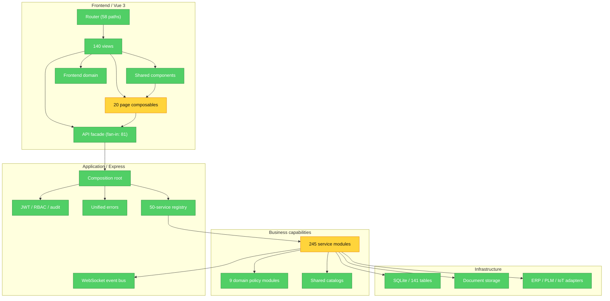

# Brooks-Lint Review

**Mode:** Architecture Audit
**Scope:** `192.168.1.73:/home/dubin/factory-mes` 全量活动源码；AST 与依赖扫描覆盖 493 个 JS/TS/Vue 文件，排除配置中的归档、构建产物、依赖、迁移和临时文件
**Config:** `.brooks-lint.yaml` applied (1 risk disabled, 17 paths ignored)
**Health Score:** 90/100
**Trend:** 64 -> 90 (+26) since the previous Architecture Audit

系统已消除上一轮的 Critical 架构热点、服务层反向依赖、DDL 静默漂移、重复工艺树副本和不可追溯部署基线；当前剩余风险集中在页面控制器长度与两个核心表的持久化写入所有权。

---

## Module Dependency Graph

### Audit Baseline

- 50 个注册服务、548 条字面 API 路由、64 个前端功能模块、58 个路由路径、141 张生产表。
- 依赖循环 0，AST 解析错误 0，活动源码重复组 0，层级反向依赖 0。
- 422/422 后端与集成测试通过；路由、模块、schema、层级四道结构闸门通过。
- 前端 `vue-tsc --noEmit` 与 Vite 生产构建通过。
- 前后端生产依赖审计均为 0 个已知漏洞，`git diff --check` 通过。
- 数据库通过参数注入形成内存 SQLite 测试 seam；Conway's Law 因团队边界信息不足不形成 finding。

---

## Findings

### Warning

**R1 Cognitive Overload - 页面控制器与少数业务编排器仍偏长**

Symptom: `frontend/src/composables/useOeePage.ts:6` 的页面控制器为 329 行，`services/andonService.js:24` 的注册编排为 312 行，`services/delivery/readModel.js:8` 的 read-model 工厂为 305 行；另有数个 250-300 行的页面控制器。它们已与 Vue 模板、SQL 数据源和领域策略分离，但单个闭包仍持有较多状态和动作。
Source: Fowler - *Refactoring*, Long Method; McConnell - *Code Complete*, High-Quality Routines.
Consequence: 新增筛选条件、图表口径或状态动作时，维护者仍需通读完整页面控制器，局部变更的审查范围偏大，未来容易重新积累隐式耦合。
Remedy: 不做无目的机械拆分；在下一次修改对应模块时，按“查询状态 / 命令动作 / 图表或响应映射”提取子 composable 或 read-model collector，并为提取边界增加定向测试。

**R6 Domain Model Distortion - 核心表写入所有权仍处过渡期**

Symptom: 状态转换策略已集中到 9 个 `app/domain` 模块，但 `shortage_cases` 仍由 BOM 风险、交付同步、采购跟催效果和缺料关闭 4 个模块直接写入；`process_nodes` 仍有排程、工艺节点、工序库、扫码和项目排程等 9 个直接写入者。相比之下，`project_cost_entries` 已收敛为单一持久化所有者。
Source: Evans - *Domain-Driven Design*, Aggregate Root and Bounded Context; Ousterhout - *A Philosophy of Software Design*, Information Leakage.
Consequence: 规则本身已经统一，但字段写入、审计和事务边界仍可能随调用方分叉；一次 schema 或状态审计变更需要同步检查多个 bounded context。
Remedy: 为 `ShortageCaseRepository` 和 `ProcessRouteRepository` 建立唯一写入口；跨模块流程只调用领域用例并发布事件，读模型可继续直接查询，禁止新增第 5 个或第 10 个表写入者。

---

## Summary

本轮架构健康度从 64 提升到 90，所有上一轮 Critical 及部署可追溯性问题已关闭，且依赖图保持无循环。下一轮应只围绕真实业务变更渐进拆分长控制器，并优先把 `shortage_cases`、`process_nodes` 的持久化写入收敛到单一 repository；不建议继续按文件行数机械拆分职责单一页面。
